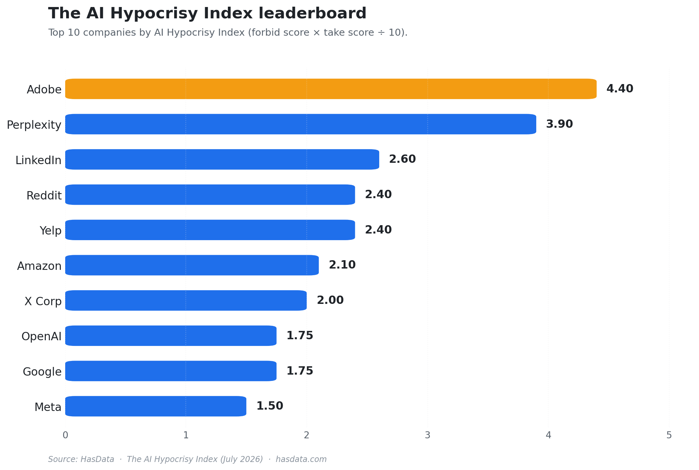
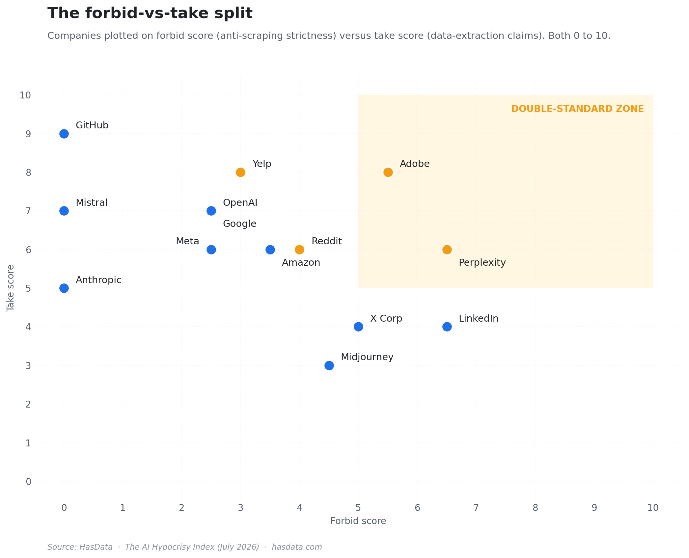
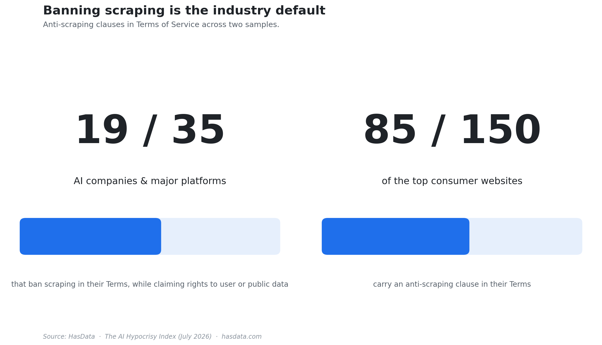
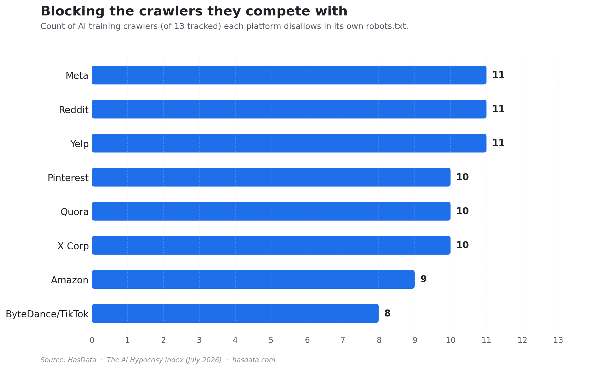
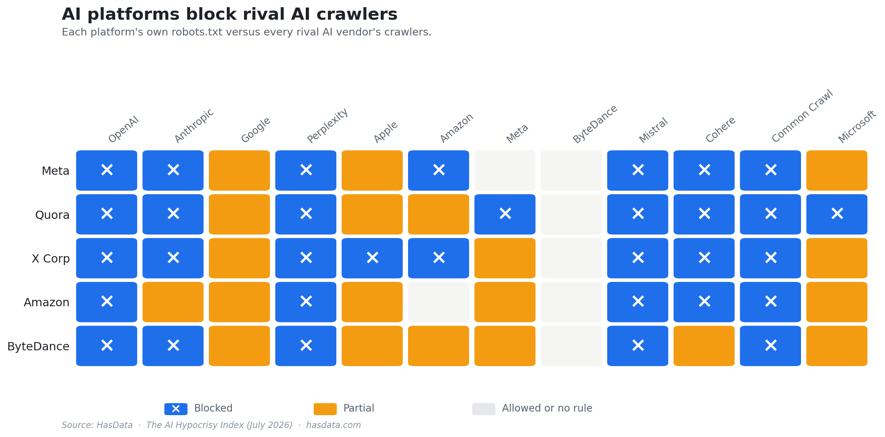
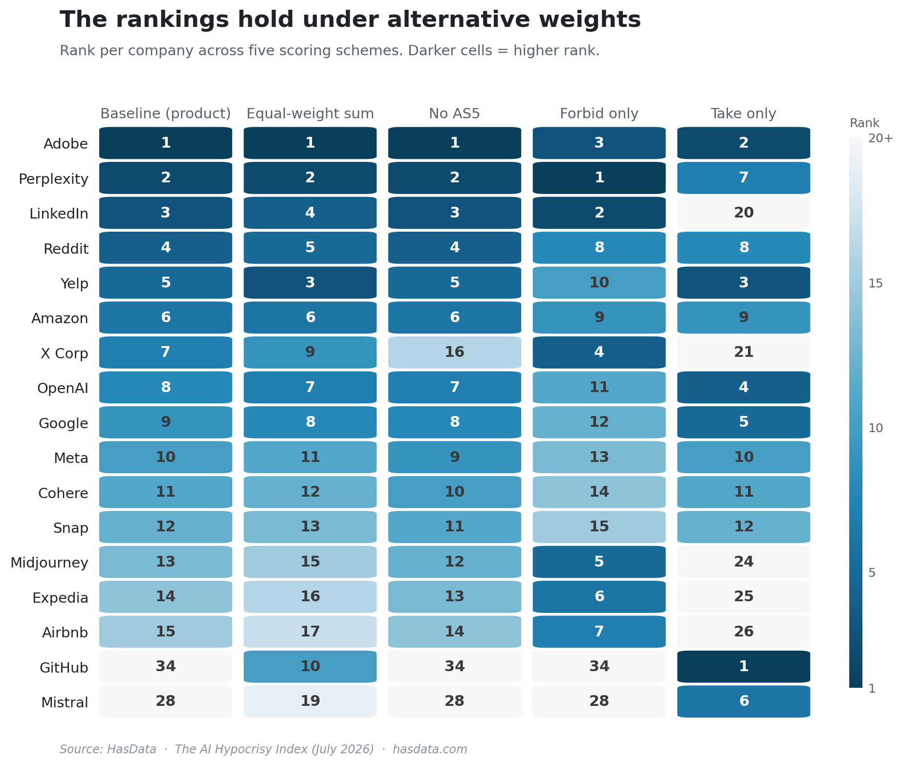

# The AI Hypocrisy Index (Dataset)


Data behind [The AI Hypocrisy Index](https://hasdata.com/blog/ai-hypocrisy-index?utm_source=github&utm_medium=syndication&utm_campaign=ai-hypocrisy-index&utm_content=ai-hypocrisy-index-readme), a HasData study of the gap between what companies forbid in their Terms of Service and what they claim over user and public data. The sample is 35 companies that build AI models or run crawlers, plus the 150 most-visited consumer websites. Every clause in the files carries a verbatim quote that was checked as an exact substring of the fetched document.

## Table of Contents

- [Key Findings](#key-findings)
- [The Sample](#the-sample)
- [Method](#method)
- [Files](#files)
- [File Schemas](#file-schemas)
- [Reproducing the Checks](#reproducing-the-checks)
- [Scope of This Release](#scope-of-this-release)
- [License](#license)
- [How to Cite](#how-to-cite)
- [Disclaimer](#disclaimer)
- [More Resources](#more-resources)

## Key Findings

Adobe tops the Index at 4.4, with a forbid score of 5.5 and a take score of 8. Perplexity follows at 3.9 and LinkedIn at 2.6. None of them disallows a single AI training crawler in its own `robots.txt`.



The content platforms hold the upper right of the forbid-against-take plane. Adobe, Perplexity, Reddit and Yelp restrict access hard in their Terms and claim broad rights over what users post.



19 of the 35 AI companies write a general scraping ban into their Terms. 85 of the 150 top consumer sites carry at least one anti-scraping clause.



Reddit, Yelp and Meta each disallow 11 AI training crawlers in their `robots.txt`, X Corp, Pinterest and Quora 10, Amazon 9 and TikTok 8.



The matrix reads each platform's `robots.txt` against the crawlers of the other AI companies in the sample.



The Terms and the `robots.txt` of one company often disagree. 13 companies forbid scraping on paper and block no AI training crawler, while Pinterest and Quora do the reverse and block crawlers with permissive Terms. 6 companies are strict on both sides and 14 on neither.

X Corp is the only company with a liquidated damages clause. The archived June 2025 version of its Terms sets $15,000 per 1,000,000 posts, and the version fetched for the study sets €15,000.

Nine companies train on user content unless the user opts out (Adobe, Anthropic, DeepSeek, GitHub, Microsoft, Mistral, OpenAI, Quora and Stability AI).

The anti-scraping wording repeats across companies. The largest cluster of near-identical quotes, the "robot, spider, scraper" template, spans 17 companies and sites.

The ranking survives re-weighting. Adobe stays in the top 5 under all five weighting schemes, and Adobe, Amazon, Perplexity, Reddit and Yelp stay in the top 10 under all of them.



The [article](https://hasdata.com/blog/ai-hypocrisy-index?utm_source=github&utm_medium=syndication&utm_campaign=ai-hypocrisy-index&utm_content=ai-hypocrisy-index-readme) quotes the clauses behind these numbers and covers the court cases around them, and every number above traces to a row in the files below.

## The Sample

Tier A is 35 companies that build AI models or operate crawlers, among them OpenAI, Anthropic, Google, Meta, Microsoft, Perplexity, Adobe, Reddit and X Corp. For each we read the Terms of Service, the Privacy Policy and `robots.txt`.

Tier B is the 150 most-visited consumer websites from the [Tranco](https://tranco-list.eu/) ranking (list `94Y82`), kept after dropping blocklisted domains and domains without consumer Terms. For Tier B we read the Terms of Service and `robots.txt` only, so every finding about Privacy Policies applies to Tier A alone. HasData's own domain was excluded to avoid a conflict of interest.

Documents were fetched on July 23, 2026 with the user agent `DoubleStandardIndexResearch/1.0`, at one request per second per domain. No paywall, login or bot protection was circumvented. Archived versions from the Wayback Machine, aimed at June of each year from 2022 to 2025, add a partial history that the study uses for context only. One Tier A Terms page rendered only with JavaScript and couldn't be read as text.

## Method

Each document was classified against a 12-clause taxonomy. Seven clauses describe anti-scraping language (AS1 to AS7) and five describe extraction (EX1 to EX5).

| Code | Clause | Weight |
|---|---|---|
| AS1 | General scraping ban | 2 |
| AS2 | Absolute ban | 2 |
| AS3 | Prior written consent required | 2 |
| AS4 | Ban on AI training with their content | 1 |
| AS5 | Liquidated damages | 2 |
| AS6 | Anti-circumvention | 0.5 |
| AS7 | API-only access | 0.5 |
| EX1 | License to user content (strong or basic) | 2 or 1 |
| EX2 | AI training on user content | 3 |
| EX3 | AI training on by default, opt-out | 1 |
| EX4 | Collection of publicly available data | 2 |
| EX5 | Data sharing or licensing | 1 |

The forbid score sums the AS weights and the take score sums the EX weights, plus 1 when the company runs its own training crawler. Both are capped at 10. The Index is `forbid_score * take_score / 10`, so it climbs only when a company scores high on both sides.

A language model read every document at temperature zero, returned strict JSON, and ran twice. A clause is reported only when its quote is found as an exact substring of the extracted text. 402 quotes passed that check and 12 failed it and were dropped.

A crawler counts as blocked when the `robots.txt` rules that apply to its user agent disallow the site root, whether they come from its own group or from `*`. The block count covers the 11 crawlers that `crawler_registry.csv` lists with the purpose `training`. The thresholds for the four groups are a forbid score of 2.5 and at least one blocked training crawler.

## Files

Everything lives in `data/`. The CSV files are the primary format, and `double_standard_index.xlsx` holds the same tables as sheets with a `_meta` sheet on top.

| File | Rows | What it holds |
|---|---|---|
| `data/double_standard_ledger.csv` | 35 | One row per Tier A company, with the Index, both scores, the robots count and the quote behind each side |
| `data/scores.csv` | 35 | The per-clause components of the forbid and take scores |
| `data/evidence.csv` | 402 | Every verified clause quote, current and archived |
| `data/clauses_current.csv` | 1,993 | Every clause check on the current documents, found and not found |
| `data/clauses_history.csv` | 1,176 | The same checks on archived and current versions together |
| `data/documents.csv` | 269 | Every fetched document version with its hash |
| `data/robots_matrix.csv` | 197 | Each domain's `robots.txt` rule for 26 crawlers |
| `data/ai_vs_ai_matrix.csv` | 24 | 24 Tier A domains against the 23 crawlers whose operators are in Tier A |
| `data/crawler_registry.csv` | 26 | The crawler user agents, their operator and purpose |
| `data/tierB_summary.csv` | 150 | The Tier B sites with their Tranco rank and clause counts |
| `data/damages_table.csv` | 2 | The X Corp liquidated damages clause in two versions of its Terms |
| `data/methodology_meta.json` | | Collection date, model, weights, exclusions and library versions |

The ledger is the one to start with, since one row per company carries the Index and the quotes that drive it.

## File Schemas

The ledger, `double_standard_ledger.csv`, carries `hypocrisy_index`, `forbid_score` and `take_score`, the robots count `robots_blocks_ai_training_bots`, yes or no flags for the key clauses (`forbids_scraping_AS1`, `forbids_ai_training_AS4`, `trains_on_user_content_EX2`, `content_license_EX1`, `claims_public_data_EX4`), `training_default` (`optout`, `optin` or empty), `license_perpetual_or_irrevocable`, the crawler columns `operates_training_crawler` and `own_crawlers`, and two quotes. The `forbid_quote` column holds the strongest anti-scraping clause and `take_quote` the strongest extraction clause.

The scores file breaks each score into its parts, one column per clause (`forbid_AS1` to `forbid_AS7`, `take_EX1` to `take_EX5`, `take_crawler`). Each cell holds the weight the company earned on that clause, so a row sums to its score before the cap.

The evidence file has one row per verified quote. Its `clause_type` column names the clause (for example `AS1_general_scraping_ban`), `doc_type` is `tos`, `tos_uk` or `privacy`, and `version_date` is the document date (July 23, 2026 for live fetches, the capture date for archived ones). The quote itself is in `verbatim_quote`, its position in the extracted text in `quote_char_offset`, and the address the document was served from in `final_url`. The `confidence` column is the model's own rating, and `passes_agreed` says whether both classification runs found the clause.

Both clause files list every company, document and clause combination that was checked, with `status` set to `found`, `not_found` or `verification_failed`. The history file adds `source` (`live` or `wayback`) and `first_seen_version`, the earliest version where the clause appears.

The documents file has one row per fetched document version. Its `doc_id` joins domain, document type, region, date and source, `tier` is `A` or `B`, and `fetch_method` is `requests`, `wayback` or `jina`. The `sha256` column is the hash of the raw response, `simhash` a fingerprint of the text and `word_count` the length of the extracted text, while `unchanged_from_previous` names the earlier version when the text didn't change.

The robots matrix has one column per crawler user agent. Each cell is `disallowed` (the site root is closed to that crawler), `partial` (only some paths are closed), `allowed` or `no_robots`, and `blocks_ai_training_bots_count` counts the `disallowed` cells among the 11 training crawlers. The smaller `ai_vs_ai_matrix.csv` uses the same values.

The registry maps each user agent to `operator_company` and `purpose` (`training`, `search`, `user_fetch` or `mixed`), with `official_doc_url` pointing at the operator's own documentation and `evidence_grade` set to `official` or `reported`.

The Tier B summary lists each domain with `tranco_rank`, the clause codes found (`anti_scraping_clauses_found`, joined by semicolons), `as_clause_count`, `robots_blocks_ai_training_bots` and `has_robots`.

The damages table holds `version_date`, `amount`, `currency`, `per` and the clause quote for each of the two X Corp versions.

## Reproducing the Checks

The `method/` folder holds three scripts that recompute the study's checks from the CSV files. They need only the Python standard library and write their output to `method/results/`.

The first script, `test_a_robots_vs_terms.py`, splits the 35 companies into paper-only forbidders, silent enforcers, aligned strict and aligned lax. The second, `test_b_clause_similarity.py`, groups the anti-scraping quotes by wording and finds the shared templates. The third, `test_c_alt_weights.py`, ranks the companies under five weighting schemes (the baseline product, an equal-weight sum, the baseline without liquidated damages, forbid only and take only).

```bash
python method/test_a_robots_vs_terms.py
python method/test_b_clause_similarity.py
python method/test_c_alt_weights.py
```

The results shipped in `method/results/` are the output of these runs on the files in `data/`.

## Scope of This Release

This release ships every table of the study and the full quote set. The raw document texts aren't included, since the documents belong to the companies that publish them. The `sha256` column in `documents.csv` identifies each fetched version, and `final_url` leads back to the source. The `path_text`, `path_raw` and `evidence_saved_path` columns name files in the working copy and are kept only as identifiers.

The text-level files cover 197 domains, the 35 Tier A companies plus 162 Tier B candidates. The Tier B summary lists the 150 that make up Tier B in every count, and 10 of the 402 quotes come from the 12 candidates outside it.

## License

The dataset is released under [CC BY 4.0](LICENSE). You can copy, share, and adapt it, including commercially, as long as you credit HasData with a link to [hasdata.com](https://hasdata.com?utm_source=github&utm_medium=syndication&utm_campaign=ai-hypocrisy-index&utm_content=ai-hypocrisy-index-readme) or the [study](https://hasdata.com/blog/ai-hypocrisy-index?utm_source=github&utm_medium=syndication&utm_campaign=ai-hypocrisy-index&utm_content=ai-hypocrisy-index-readme).

## How to Cite

Cite the study when you use its findings.

> HasData. (2026). *The AI Hypocrisy Index*. HasData. https://hasdata.com/blog/ai-hypocrisy-index

```bibtex
@misc{hasdata_ai_hypocrisy_index,
  author       = {{HasData}},
  title        = {The AI Hypocrisy Index},
  year         = {2026},
  howpublished = {\url{https://hasdata.com/blog/ai-hypocrisy-index}}
}
```

Every GitHub release of this repository is also archived on Zenodo with its own DOI, for work that has to point at the exact files it used. GitHub's "Cite this repository" button in the sidebar gives the study reference in APA and BibTeX.

## Disclaimer

The data comes from publicly available Terms of Service, Privacy Policies and `robots.txt` files, collected for research. It records what companies write in their own documents. Whether a court would enforce any of it is a separate question, and nothing in this repository is legal advice. [Is Web Scraping Legal?](https://hasdata.com/blog/is-web-scraping-legal?utm_source=github&utm_medium=syndication&utm_campaign=ai-hypocrisy-index&utm_content=ai-hypocrisy-index-readme) covers how we think about the question.

## More Resources

- [The AI Hypocrisy Index](https://hasdata.com/blog/ai-hypocrisy-index?utm_source=github&utm_medium=syndication&utm_campaign=ai-hypocrisy-index&utm_content=ai-hypocrisy-index-readme), the study this data belongs to
- [The AI Crawler Block Index](https://hasdata.com/blog/ai-crawler-block-index?utm_source=github&utm_medium=syndication&utm_campaign=ai-hypocrisy-index&utm_content=ai-hypocrisy-index-readme), how 10,894 top domains block AI crawlers on paper and in practice
- [User Agents for Web Scraping](https://hasdata.com/blog/user-agents-for-web-scraping?utm_source=github&utm_medium=syndication&utm_campaign=ai-hypocrisy-index&utm_content=ai-hypocrisy-index-readme)
